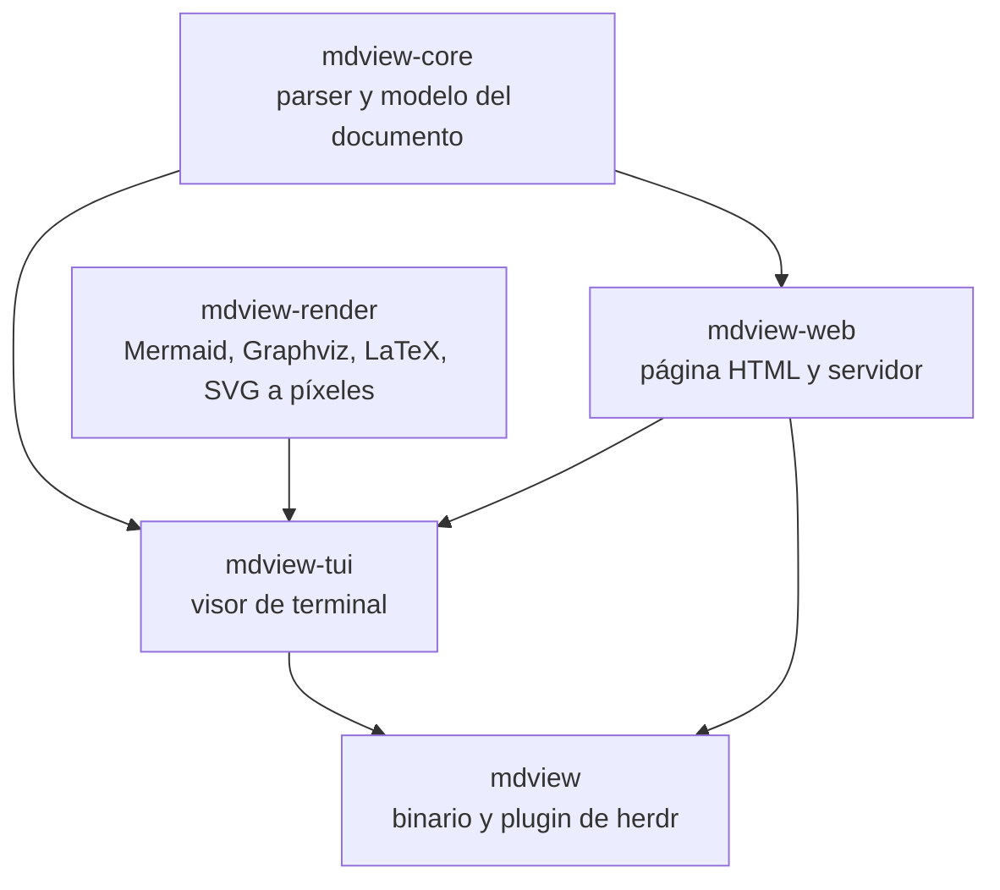

# mdview

Visor de Markdown escrito en Rust. Funciona como **plugin de [herdr](https://herdr.dev)**,
como visor de terminal independiente y como vista previa en el navegador.

Dibuja Markdown completo (GFM): tablas, listas de tareas, alertas, notas al pie,
listas de definición, front matter, sub y superíndices, wikilinks, código con
resaltado, **diagramas Mermaid y Graphviz**, **fórmulas LaTeX** e imágenes.
Recarga solo cuando el archivo cambia.

## Instalar el plugin en herdr

Requisitos: herdr 0.9 o superior y `cargo`.

Desde GitHub:

```bash
herdr plugin install Freddy-system/herdr-mdview
```

Desde una copia local:

```bash
cargo build --release --bin mdview
herdr plugin link /ruta/a/este/repositorio
```

Para tener el comando `mdview` en la terminal:

```bash
cargo install --git https://github.com/Freddy-system/herdr-mdview mdview
```

Para abrirlo con una tecla, añade esto a `~/.config/herdr/config.toml` y ejecuta
`herdr server reload-config`:

```toml
[[keys.command]]
key = "prefix+m"
type = "plugin_action"
command = "mdview.open"
description = "vista previa de Markdown"
```

### Cómo se usa dentro de herdr

| Qué haces | Qué pasa |
|---|---|
| Pulsas la tecla configurada | Se abre un panel a la derecha con el `README.md` de la carpeta del panel activo, o un selector de archivos si no hay README |
| Escribes `mdview open notas.md` en un panel | Se abre ese archivo en un panel a la derecha |
| Escribes `mdview open` en un panel | Se abre el README de la carpeta actual, o el selector |
| Seleccionas una ruta `.md` y pulsas la tecla | Se abre ese archivo |
| Ctrl-clic sobre un enlace a un `.md` local | Se abre ese archivo |
| `herdr plugin action invoke mdview.open-tab` | Lo mismo, en una pestaña nueva |
| `herdr plugin action invoke mdview.open-overlay` | Lo mismo, en un panel superpuesto |

### Teclas del visor

| Tecla | Acción |
|---|---|
| `j` `k` `↑` `↓`, rueda | Desplazar |
| `d` `u`, `Espacio`, `RePág` `AvPág` | Media página / página |
| `g` `G` | Inicio / final |
| `/`, `n` `N` | Buscar, coincidencia siguiente / anterior |
| `Tab`, `Mayús-Tab`, `Enter`, clic | Elegir y seguir enlaces (entre documentos y a títulos) |
| `Retroceso` | Volver al documento anterior |
| `t` | Índice del documento |
| `f` | Selector de archivos |
| Arrastrar con el ratón | Seleccionar texto; al soltar queda copiado |
| `y`, clic sobre un bloque de código | Copiar el bloque al portapapeles |
| `Y`, `Ctrl+A` | Copiar el documento entero (fuente Markdown) |
| `o` | Abrir en el navegador |
| `i` | Cambiar modo de imágenes (`kitty` / `text`) |
| `c` | Colores claros / oscuros |
| `?` | Mostrar u ocultar el panel de ayuda con todas las teclas |
| `r`, `q` | Recargar, salir |

## Diagramas e imágenes: tres niveles

herdr solo ofrece a los plugins paneles de terminal, así que la calidad de los
gráficos depende del terminal en el que corre herdr:

1. **Modo `kitty`**: imagen real. Los diagramas y las fórmulas se dibujan como
   imágenes nítidas con el protocolo gráfico de Kitty. Funciona en Kitty,
   Ghostty, WezTerm y Konsole.
2. **Modo `text`**: para terminales sin imágenes, como Alacritty. Mermaid se
   dibuja con caracteres de caja, las fórmulas con símbolos Unicode y las
   imágenes con medios bloques de color.
3. **Navegador** (`o`): fidelidad completa en cualquier terminal. Usa Mermaid,
   KaTeX y Graphviz originales, con recarga en vivo.

mdview elige el modo según el terminal que detecta; `i` lo cambia y recuerda la
elección. Graphviz no tiene modo de texto: en `text` se ve en baja resolución y
conviene abrirlo en el navegador.

Variables de entorno:

| Variable | Efecto |
|---|---|
| `MDVIEW_GRAPHICS=kitty\|text` | Fuerza el modo de imágenes |
| `MDVIEW_THEME=light\|dark` | Colores iniciales |
| `MDVIEW_CELL=10x20` | Tamaño de celda en píxeles que se asume al dimensionar imágenes |
| `MDVIEW_MOUSE=0` | No capturar el ratón (para seleccionar texto con el terminal) |

Si `plantuml` o `d2` están instalados, sus bloques de código también se dibujan.

## Uso fuera de herdr

```bash
mdview README.md            # visor de terminal
mdview docs/                # selector de archivos de una carpeta
mdview serve docs/          # vista previa en el navegador con recarga en vivo
mdview export README.md     # escribe README.html
```

La vista de navegador carga Mermaid, KaTeX, highlight.js y Graphviz desde un
CDN, así que la primera vez necesita conexión. El servidor solo escucha en
`127.0.0.1` y no sirve nada fuera de la carpeta indicada.

## Arquitectura

Cada pieza es un crate independiente. Los frontends no se conocen entre sí;
todos parten del mismo modelo de documento.



| Crate | Responsabilidad |
|---|---|
| `mdview-core` | Convierte Markdown en un árbol de bloques. Aquí se añade sintaxis nueva una sola vez para todos los frontends |
| `mdview-render` | Motores de diagramas tras el trait `DiagramEngine`. Un lenguaje nuevo es un motor nuevo registrado en `Registry` |
| `mdview-tui` | Maquetado a líneas de terminal, imágenes Kitty o texto, y la aplicación interactiva |
| `mdview-web` | Página HTML autocontenida y servidor local con recarga en vivo |
| `mdview` | Línea de comandos y el pegamento con herdr (`herdr-plugin.toml`) |

## Plan: VS Code y aplicación de escritorio

Aún no están implementados. Ambos reutilizan `mdview-web`, que ya produce la
página completa, así que no añaden código de renderizado propio.

**Extensión de VS Code**

1. Extensión en TypeScript con un comando «mdview: Abrir vista previa» que crea
   un `WebviewPanel` junto al editor.
2. La extensión arranca `mdview serve` sobre la carpeta del workspace y carga la
   página en el webview; la recarga en vivo ya la da el servidor.
3. Sincronizar el desplazamiento editor ↔ vista previa mediante mensajes del
   webview, usando los `id` de los títulos que el núcleo ya genera.
4. Empaquetar el binario por plataforma dentro del `.vsix`. Alternativa sin
   binario: compilar `mdview-core` y `mdview-web` a WebAssembly.
5. Incluir Mermaid, KaTeX y highlight.js dentro de la extensión, porque los
   webviews bloquean los CDN por defecto.

**Aplicación de escritorio (Linux, Windows, macOS)**

1. Envoltorio con Tauri: una ventana cuyo contenido es la página de
   `mdview-web`, con `mdview-core` enlazado directamente en el proceso Rust.
2. Menú nativo, abrir archivo o carpeta, arrastrar y soltar, archivos recientes
   y asociación con la extensión `.md`.
3. Recursos web incluidos en el instalador para que funcione sin conexión.
4. Instaladores por plataforma (`.deb`, AppImage, `.msi`, `.dmg`) generados en CI.

Trabajo previo común a los dos: mover los recursos del CDN al propio paquete.

## Desarrollo

```bash
cargo test --workspace
cargo fmt --all
cargo run -- examples/demo.md
```

`examples/demo.md` recorre todo lo que el visor sabe dibujar.

El plugin declara `linux` y `macos`. Windows queda pendiente: el manifiesto
apunta a `target/release/mdview`, sin `.exe`.

## Licencia

MIT © 2026 Freddy Sedano. Consulta [LICENSE](LICENSE). Cualquier copia o trabajo
derivado debe conservar el aviso de copyright y el texto de la licencia.
