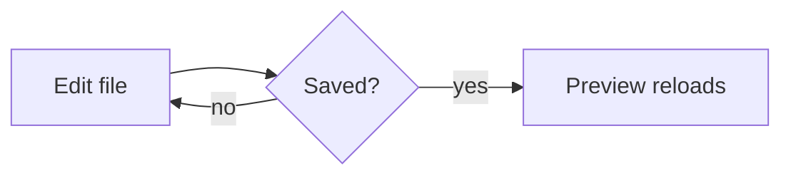
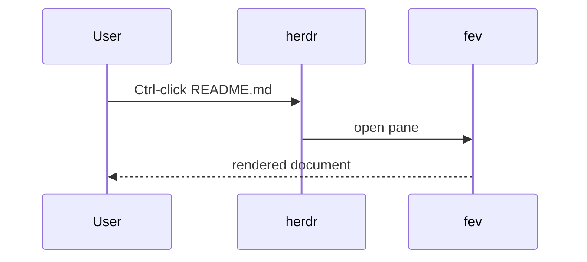
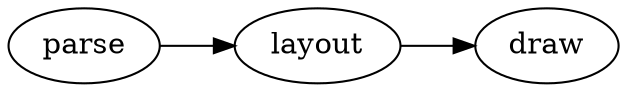

# File Editor & Viewer demo

A tour of what the previewer draws. Press `?` for keys, `t` for the contents,
`o` to open this page in the browser.

## Text

Plain, *emphasis*, **strong**, ***both***, ~~struck~~, `inline code`,
H~2~O, x^2^, a [link to the guide](guide.md#second-part), a footnote[^1] and
inline math $e^{i\pi} + 1 = 0$.

> A plain quote
> spanning two lines.

> [!NOTE]
> Alerts are supported.

> [!WARNING]
> Including the scary ones.

## Lists

- First
  - Nested item
  - Another
- Second

1. One
2. Two

- [x] Parse Markdown
- [x] Draw diagrams
- [ ] Take over the world

Term
: Its definition.

## Table

| Feature        | Terminal            | Browser |
|:---------------|:-------------------:|--------:|
| Mermaid        | text or image       | native  |
| Math           | Unicode or image    | KaTeX   |
| Live reload    | yes                 | yes     |

## Code

```rust
fn main() {
    let greeting = "hello";
    println!("{greeting}, world");
}
```

## Mermaid





## Graphviz



## Math

$$
\int_0^1 x^2 \, dx = \frac{1}{3}
$$

## Image


---

<div align="center"><b>The end</b></div>

[^1]: Footnotes are collected at the bottom.
